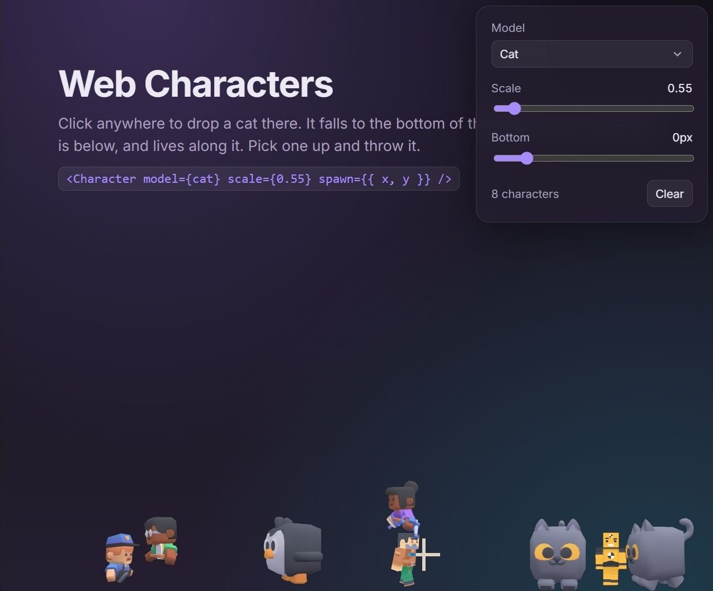

# Cat walk 🐈

**A cat walking along the bottom of your browser.**



`@n1h/web-characters` puts an animated glTF character on any web page: a see-through canvas that drops a model in at a point, lands it on the bottom edge of the page (or on another character's head), and lets it live there: idle, walk, run, do whatever its clips do, turn around at the sides, bump into the others, be picked up and thrown.
Clicks beside a character reach the page as if the canvas were not there.
[Babylon.js](https://www.babylonjs.com/) underneath; a framework-free `createCharacter()` and a React `<Character>`.

The models come as packs, one npm package each, one module per model, so a build ships only the models a page imports:

| Package                                                                                      | Holds                                                                                                                                                   |
| -------------------------------------------------------------------------------------------- | ------------------------------------------------------------------------------------------------------------------------------------------------------- |
| [`@n1h/web-characters`](packages/web-characters/README.md)                                   | the core: the scene, the life, the ground the characters share, the pointer, `createCharacter`, `<Character>`, the `ModelSpec` type for your own models |
| [`@n1h/web-characters-cube-pets`](packages/web-characters-cube-pets/README.md)               | Kenney's 24 Cube Pets, CC0: `cat`, `dog`, `fox`, …                                                                                                      |
| [`@n1h/web-characters-block-characters`](packages/web-characters-block-characters/README.md) | Kenney's block-style people, CC0: four Blocky Characters and six Mini Characters                                                                        |

## Install

```sh
bun add @n1h/web-characters @n1h/web-characters-cube-pets
```

The core depends on `@babylonjs/core` and `@babylonjs/loaders`; React is an optional peer for the `<Character>` component.
The packages ship TypeScript sources; your bundler compiles them, and handles the `.glb` and `.png` imports inside the packs as asset URLs (Bun, Vite and esbuild do by default; webpack needs asset modules).

## Quickstart

```ts
import { createCharacter } from "@n1h/web-characters";
import { cat } from "@n1h/web-characters-cube-pets/cat";

const kitty = createCharacter({ model: cat, spawn: { x: 300, y: 0 }, scale: 1.5 });
kitty.setSettings({ scale: 2 });
kitty.spawn({ x: 800, y: 0 }); // teleport and fall again
kitty.dispose();
```

In React:

```tsx
import { Character } from "@n1h/web-characters/react";
import { cat } from "@n1h/web-characters-cube-pets/cat";
import { characterA } from "@n1h/web-characters-block-characters/blocky/a";

<Character model={cat} spawn={{ x: 300, y: 0 }} scale={1.5} />
<Character model={characterA} spawn={{ x: 600, y: 0 }} />
```

Drop several and they land on each other's heads, ride along, walk off, and keep out of each other's way at ground level.

## Documentation

[`docs/README.md`](docs/README.md) is the index: [the core](docs/core.md) (`createCharacter`, `<Character>`, the handle, the settings), [the model spec](docs/model-spec.md) (how to describe any animated glTF), [packs](docs/packs.md) (how a pack package is made and why one module per model), and [how it works](docs/internals.md).

## Demo

`just demo` bundles the page in `demo/` and serves it on `http://127.0.0.1:4748`. A click anywhere drops a character at that point; the panel picks the model from the packs and sets the scale and the bottom of every character. Pick one up and throw it; drop one on another. The demo imports the packs whole, so its bundle ships every file.

## Development

Bun, `just` and `pwsh` (the recipe shell on every OS).

| Recipe                                                                                   | Does                                                                                                                                                                                                                      |
| ---------------------------------------------------------------------------------------- | ------------------------------------------------------------------------------------------------------------------------------------------------------------------------------------------------------------------------- |
| `just demo`                                                                              | the demo page, built and served                                                                                                                                                                                           |
| `just check`                                                                             | `tsc --noEmit` over every package and the demo, then `bun test` (the core's life, framing, spec and settings tests; the packs' spec tests; a test that bundles a page importing one animal and counts the files it ships) |
| `just web-characters pack`, `just cube-pets pack`, `just block-characters pack`          | what each tarball would hold                                                                                                                                                                                              |
| `just web-characters publish`, `just cube-pets publish`, `just block-characters publish` | `bun publish --access public` for that package, skipped when its version is already on the registry                                                                                                                       |
| `just publish-all`                                                                       | `check`, then every package whose version is new                                                                                                                                                                          |

A release: bump the version in the package(s) that changed (a pack that depends on a new core also bumps its peer range), commit, `just publish-all`.

## License

MIT or 0BSD, your choice: `LICENSE`, `LICENSE-0BSD`. The models are Kenney's, CC0; each pack's `assets/` folder has the pack's licence.
